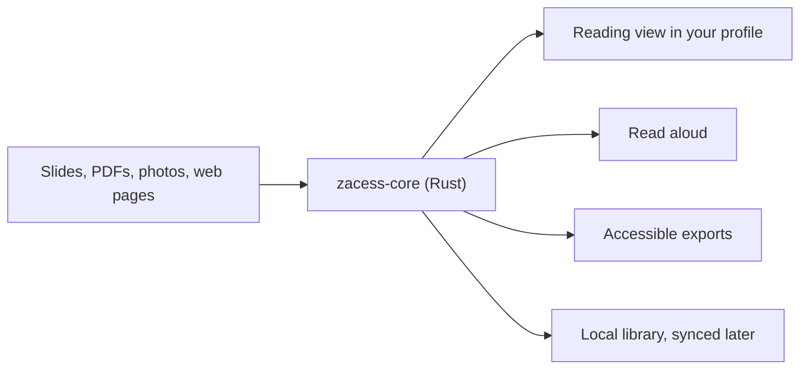

# Zacess

**Make every page accessible.**

Zacess (said like "success", za-SESS) turns lecture slides, PDFs, textbook pages, handouts, whiteboards and web
pages into structured, high-contrast notes in each reader's own reading profile. It reads them aloud
and keeps them as study material on every device, offline first.

> [!NOTE]
> Zacess is in early development. The browser version is live at [app.zacess.com](https://app.zacess.com)
> and runs entirely on the device; the apps for each platform are still being built. What it does, the
> roadmap and how it works are on [zacess.com](https://zacess.com). Each part of the core is described in
> [docs](docs).

## What we are building first (v0)

- Import PDF, PowerPoint, Word and images, with OCR where a document has no text layer
- OCR confidence highlighting, so a misread number or symbol is flagged for checking
- Reading profiles with presets for low vision, dyslexia, reduced visual clutter and screen readers
- Magnification and read aloud with word highlighting and personalised audio controls
- A reliable local library with autosave, version history and backups
- Accessible exports: HTML, EPUB3, DOCX and MP3

## How it fits together

## Browser version

The first usable slice runs in a web browser at [app.zacess.com](https://app.zacess.com), entirely on the
device: open a PDF, an image, a Word file, a web page or pasted text, read it in a reading profile,
listen to it and export accessible HTML or EPUB. How it is built, what it keeps private and how it is
checked are in [Browser version](docs/browser-version.md).

## Planned layout

| Path | What lives there |
| --- | --- |
| `crates/zacess-core` | The Rust engine: document model, reading profiles, import, export |
| `crates/zacess-quality` | The scorer for the document quality test suite |
| `crates/zacess-wasm` | The core compiled to WebAssembly for the browser version |
| `apps/web` | The browser version: React, shadcn/ui and the core as WebAssembly. See [Browser version](docs/browser-version.md) |
| `apps/app` | The app for every platform (Tauri with a TypeScript interface) |
| `workers/processing` | Python workers for heavy layout and OCR jobs |
| `tests/fixtures` | The document quality test suite and the sample audio, images and web pages for the speech and capture tests |
| `tools/accessibility` | The WCAG check run on exported HTML in CI |
| `docs` | The product plan and design notes |

## Contributing

See [CONTRIBUTING.md](CONTRIBUTING.md).

## Licence

Zacess is free software under the [GNU Affero General Public License v3.0](LICENSE).
