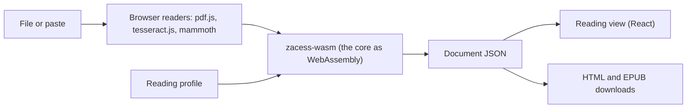

# Browser version

The first usable slice of Zacess in a web browser, to be hosted at `app.zacess.com`. The interface
lives in `apps/web` and the core reaches the browser through `crates/zacess-wasm`.

## Done when

The slice is done when all of these hold. Testing with screen readers and with disabled students is
the one item that cannot be checked here.

1. A PDF, an image, a Word file (.docx), a web page (.html), a text or Markdown file or pasted text
   or web page HTML opens into a Zacess document, entirely on the device. A PDF page with no text
   layer and an image go through OCR. Doubtful words are marked exactly as the core marks them.
2. Opening shows its progress in a polite live region and any failure as an alert that says what
   happened and what can be opened.
3. The reading view is real HTML built by the core from the document (headings, lists, tables,
   image descriptions and equations), with the app's lockup as the only `h1`.
4. The core's presets and the controls for text size (up to 96 pt), line spacing, letter spacing,
   column width and colour theme change the reading view at once, are fully keyboard operable and
   are kept in this browser. The text reflows at every size and the page never scrolls sideways.
5. A reading ruler follows the pointer, the keyboard focus and the sentence being read.
6. Read aloud uses only voices that run on the device unless online voices are switched on by a
   clearly labelled setting. It has play, pause, stop, previous and next sentence and a speed
   control, highlights the sentence being read and starts from the paragraph last clicked or
   selected.
7. Accessible HTML and EPUB 3 downloads come from the core, in the current reading profile.
8. Links in a PDF, a web page, a Word file or a pasted address work as described under
   [Links](#links): real links, never shown by colour alone, listed in a panel, read with a cue and
   never fetched by the app.
9. The app says that files never leave the device, makes no request to any other origin and keeps
   no account, cookie or analytics.
10. axe-core finds no WCAG 2.2 A or AA violations on the main screens, in jsdom and in Chromium,
    and no AAA contrast violation in the reading view. Every control is labelled, focus is always
    visible, there is a skip link and landmarks, colour is never the only signal, motion follows
    the reduced motion setting and the layout works at 320 pixels wide.
11. Testing with VoiceOver, NVDA, JAWS, TalkBack and Orca and with students who use them is done by
    people with the assistive technology, before the first release.

## Architecture



| Part | What it does |
| --- | --- |
| `crates/zacess-wasm` | Plain functions over strings and bytes (`lib.rs`, `links.rs`), tested natively, plus thin `wasm-bindgen` bindings (`bindings.rs`) built only for `wasm32` |
| pdf.js | Reads each page's text layer as positioned text and its link annotations. Pages with no text are drawn to a canvas for OCR |
| tesseract.js | Recognises images and scanned pages in a worker, with a confidence for every word |
| mammoth | Turns a Word file into HTML, which the core reads with the universal capture HTML reader |
| The core | Lays out positioned text and OCR words with the same layout analysis as the desktop, reads HTML, text and Markdown, applies the reading profile and writes the exports |
| React, shadcn/ui on Radix, Tailwind | The interface, rendered as real HTML |

Every document and profile crosses the boundary in its documented JSON form
([document model](document-model.md), [reading profiles](reading-profiles.md)). The reading view
uses the export's own markup in an `<article>` instead of `<main>`, with each heading one level
lower. The profile's style sheet is scoped to the view.

### What the browser build leaves out

`zacess-core` has a default `library` feature that brings in the SQLite library store
(`rusqlite`). The browser build turns default features off, so it carries no SQLite and keeps
nothing on disk yet. The native build and every existing test keep the feature on and are
unchanged. The command line adapters (Tesseract, Poppler, liblouis, whisper.cpp) still compile for
WebAssembly, where starting a process is unsupported, so their detection finds nothing; the browser
build never calls them and the linker drops them.

WebAssembly in a browser has no clock, so the EPUB's `dcterms:modified` time is passed in by the
page through `ExportOptions::modified`.

### Building

```sh
rustup target add wasm32-unknown-unknown
cargo install wasm-bindgen-cli --version 0.2.129   # must match the version in Cargo.lock
npm ci
npm run build -w apps/web    # the core, the OCR and PDF assets, a type check and the static dist
npm test -w apps/web         # Vitest, Testing Library and axe-core in jsdom
npm run check:browser -w apps/web   # the built app in Chromium, after npx playwright install chromium
```

`wasm-opt` from Binaryen shrinks the core further when it is installed. `npm run build` writes a
static site to `apps/web/dist` that any static host can serve; `public/_headers` carries the same
security headers for Cloudflare Workers static assets.

### Deploying

The browser version is served from `app.zacess.com` by Cloudflare Workers static assets, configured
in `apps/web/wrangler.jsonc`. No server code runs: Cloudflare serves `dist` with the `_headers`
rules and sends every unknown path to the app's single page.

```sh
cd apps/web
npm run build
npx wrangler deploy --autoconfig=false
```

## Privacy

- Files are read in the page and never uploaded. There is no account, no cookie and no analytics.
- The built page carries a Content Security Policy that allows scripts, styles, fonts, workers and
  requests from its own origin only (`connect-src 'self'`). The browser check records every request
  and fails if one leaves the origin.
- The OCR worker, its WebAssembly engines and the English language data, the pdf.js worker,
  character maps, standard fonts and image decoders and the Atkinson Hyperlegible fonts are all
  served by the app itself. Nothing is loaded from a third-party CDN.
- tesseract.js keeps the language data in the browser's IndexedDB after the first use, so OCR
  works offline afterwards.
- Online voices are off by default. The setting that turns them on says that the text is sent to
  the company that provides the voice.
- Settings (the reading profile, the app colours, the voice, speed and link reading) are kept in
  `localStorage`. Every read and write is guarded so the app still works when storage is blocked.

### More OCR languages

Only English is bundled (`eng.traineddata.gz`, the 4.0.0 `best_int` model, about 3 MB). Other
languages will be served from Cloudflare R2 under the app's own domain, since Workers static assets
cap a single file at 25 MiB. The app will offer a language list, download a language only when the person chooses
it and keep it in IndexedDB like English. The `langPath` the worker uses and the Content Security
Policy's `connect-src` will then name that R2 domain and nothing else.

## Links

| Source | How links are found |
| --- | --- |
| PDF | pdf.js reads the page's Link annotations. A text item that crosses a link area is split there, widened to whole words, so only the linked words become a run with `Run.link`. Links to places inside the PDF have no address and stay plain text for now |
| Web page, pasted page, Word file | The core's HTML reader keeps `<a href>` as it does for universal capture |
| Text, Markdown, pasted text | A bare `http://` or `https://` address becomes a link on exactly that address. Trailing `.`, `,`, `;`, `:`, `!`, `?`, quotes and closing brackets are left out, except a closing bracket the address itself opened |

In the reading view:

- Only `http`, `https` and `mailto` addresses are links. Anything else, including `javascript:`,
  `data:`, `ftp:` and in-page addresses, is turned back into plain text.
- A link is underlined and followed by a small external link icon, so it is never shown by colour
  alone. It opens in a new tab with `rel="noopener noreferrer"` and says "(opens in a new tab)" to
  screen readers.
- The full address appears in a small box beside the link under the pointer or the keyboard focus.
  The box can be hovered and is dismissed with Escape.
- A "Links in this document" button opens a list of every link with its text and address, in
  reading order. Choosing one moves the focus to that link in the document.
- Read aloud says a link's text followed by "(link)" and never the address, unless "Read web
  addresses aloud" is switched on. A link written as a bare address is read as "a web link".
- The app never fetches, prefetches or previews a linked page. A link is only followed when the
  person activates it.
- Both exports keep the links.

## Checks

| Check | Where |
| --- | --- |
| The wasm-facing functions | `cargo test -p zacess-wasm` (native) |
| Opening text, HTML and Word fixtures, profiles, exports, voices, read aloud, links and keyboard use | `apps/web/src/test/*.test.tsx` with Vitest and Testing Library |
| axe-core, WCAG 2.0, 2.1 and 2.2 A and AA, on the first screen, an open document, the dark theme, an error and the links list | `apps/web/src/test/a11y.test.tsx` and `links.test.tsx` (jsdom has no layout, so contrast is checked in Chromium) |
| The built app in Chromium at 1280 and 375 pixels, light and dark: opening a text file, a PDF with a link annotation and a scan through OCR, a preset change, an HTML export, axe including AAA contrast in the reading view, no sideways scroll at 96 pt and no request to another origin | `apps/web/scripts/check-browser.mjs` |
| The browser build of the core | `cargo clippy -p zacess-wasm --target wasm32-unknown-unknown` |

CI runs all of them in the "Browser version" job.

## Sizes

Measured on the first build, before compression on the server.

| Part | Size | Gzipped | Loaded |
| --- | --- | --- | --- |
| The core (`zacess_wasm_bg.wasm`, after `wasm-opt -Oz`) | 440 KB | 177 KB | At start |
| App JavaScript (React, Radix and the app) | 341 KB | 107 KB | At start |
| pdf.js and its worker | 420 KB and 1.2 MB | 125 KB and 366 KB | On the first PDF |
| mammoth | 301 KB | 92 KB | On the first Word file |
| tesseract.js and its worker | 17 KB and 109 KB | | On the first OCR |
| One tesseract engine (of three copied, chosen by the browser's SIMD support) | 3.9 MB | | On the first OCR |
| English OCR data | 3 MB (already compressed) | | On the first OCR, then cached |

## Known limits

- PowerPoint import, machine translation, braille export and the capture apps are not in this
  slice. Braille needs liblouis built for WebAssembly.
- A PDF with no text layer is recognised at about 144 dots per inch, lower than the desktop's 300,
  to keep memory use in the browser modest.
- Positions inside a PDF text item are estimated from its width, so a link area that starts or ends
  inside a word links the whole word.
- The Dyslexia-Friendly preset names Lexend, which is not bundled yet; the reading view falls back
  to the system sans-serif font.
- Pausing cancels the current sentence and resuming starts it again, because pause and resume are
  unreliable in several browsers.
- Nothing is kept between visits apart from settings: the library comes to the browser later.
- The Content Security Policy for workers is set by the `_headers` file on the host; a server
  without it relies on the policy in the page.
