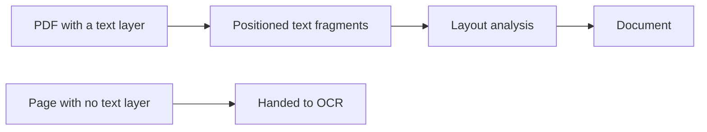

# Import

How a file becomes a [document](document-model.md). The code lives in `crates/zacess-core/src/import`.

## PDF with a text layer

`import::pdf` walks the content stream of every page with the graphics state tracked well enough to
know where each string lands on the page, how large it is and whether its font is bold. It handles
the text operators (`Tj`, `TJ`, `'`, `"`), text positioning (`Td`, `TD`, `Tm`, `T*`), spacing
(`Tc`, `Tw`, `Tz`, `TL`, `Ts`), the transformation matrix (`cm`, `q`, `Q`) and nested form XObjects.

Text is decoded through the font's ToUnicode map when it has one, which covers subset fonts and
two-byte fonts. Otherwise the named encoding is used. Glyph advances come from the font's
`Widths` or `W` array, so the position of every string is known and word gaps can be found.

A page that draws no text has no text layer. It still appears in the document's pages. Its
number is reported in `Imported::pages_needing_ocr` so OCR can fill it.

Encrypted PDFs are refused with a clear error rather than imported empty.

## Images and scans

Images and PDF pages with no text layer go through OCR. The engine, the thresholds that flag a
doubtful word or number and the way OCR words become fragments are in [ocr.md](ocr.md).

## Layout analysis

`import::layout` is shared by every importer that starts from positioned text, so OCR output goes
through the same steps.

| Step | Rule |
| --- | --- |
| Lines | Fragments on the same baseline (within 0.4 of the font size) and next to each other join one line. A gap of more than 2.5 sizes on the same baseline is another column. A space is added where the gap would otherwise run two words together |
| Blocks | A line joins the block above when it overlaps it horizontally, has the same font size and sits within 1.5 sizes of the previous baseline. Anything further apart starts a new block |
| Columns | Columns are found from the horizontal extent of ordinary blocks. A block wider than 55% of the text area spans the page and splits it into bands. Within a band, each column is read top to bottom before the column to its right |
| Furniture | A one-line block in the top or bottom 8% of the page whose text is a page number is dropped and listed separately |
| Body size | The font size most of the document's characters use |
| Headings | A block of at most three lines and 120 characters that is either at least 15% larger than the body text or bold at body size without ending in punctuation. Distinct heading sizes become levels, largest first |
| Lists | A block starting with a bullet or a short label such as `1.` or `a)` is a list item, with the marker removed. Consecutive items form one list, ordered when the markers are numbers or letters. An item indented further than the first nests under the item before it |
| Scripts | Smaller text shifted off the baseline of its line is a subscript or a superscript, kept on the run |
| Tables | Two or more consecutive rows of short, unbulleted cells whose columns line up become a table when at least half the rows hold digits. The first row is the header when it is bold or when it has no digits while the rows under it do |
| Equations | A short block with a relation such as `=` becomes an equation when it is mostly symbols, numbers and single letters or when it carries scripts. Its source is rebuilt as LaTeX |
| Hyphenation | A line ending in a hyphen followed by a lowercase line joins the word back together in the block text; the runs keep the original pieces |

Every run keeps its page and region, every block keeps the union of its runs' regions and text from
a text layer carries a confidence of 1.

## Known limits

- A table whose cells wrap onto several lines or whose columns do not line up is read as
  paragraphs.
- Rotated text is placed by its start point only.
- Standard 14 fonts without a `Widths` array use an average glyph width, which can shift where a
  space is added when a string has no spaces of its own.
